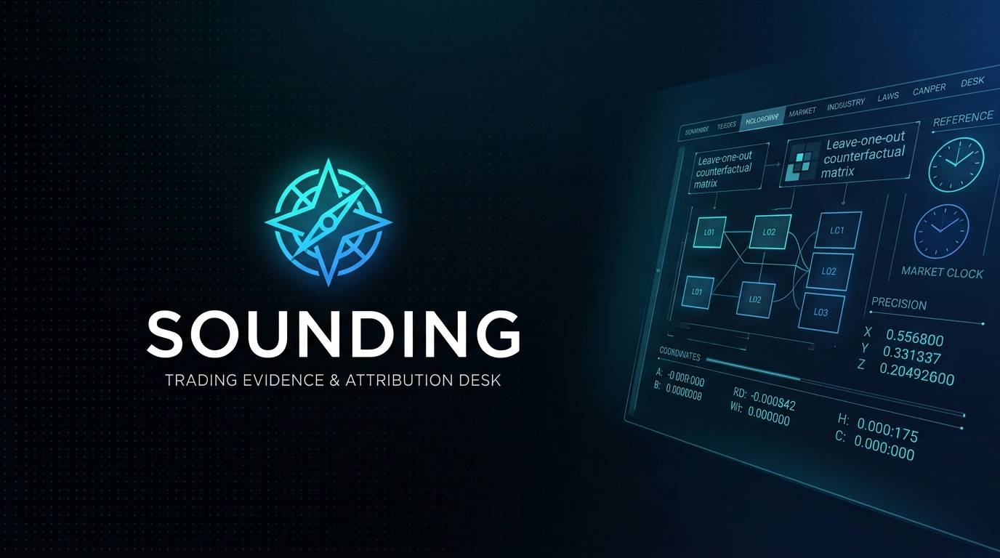
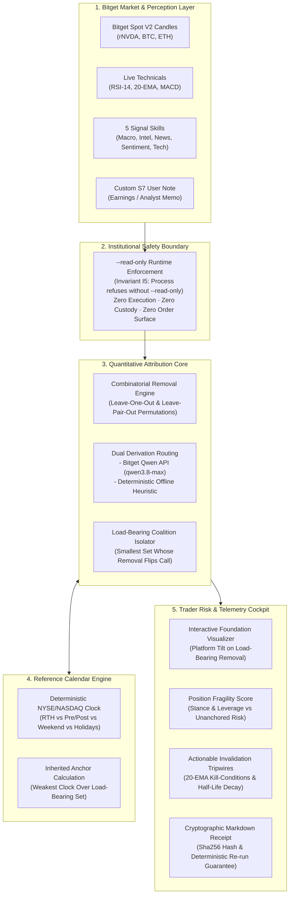

<div align="center">
  
</div>

# SOUNDING // Autonomous Attribution Trading Desk
### Bitget AI Base Camp Hackathon (Season 2) — Track 3: AI Trading Desk

[](https://github.com/natureloved/Sounding)
[](https://github.com/natureloved/Sounding)
[](https://github.com/natureloved/Sounding)
[](https://github.com/natureloved/Sounding)
[](https://github.com/natureloved/Sounding)

> **Repository Link**: [https://github.com/natureloved/Sounding](https://github.com/natureloved/Sounding)  
> **Core Value**: A read-only trading attribution desk that tells quantitative and discretionary traders what their call is *actually standing on*. Human traders make final decisions.  
> **Stack**: TypeScript, Node 24 (native `node:sqlite`), React 18, Vite 6, Bitget Spot V2 Feeds, Bitget Qwen Gateway (`qwen3.8-max`).  
> **UI Archetype**: Vanguard High-End Fintech with double-bezel glassmorphism, Plus Jakarta Sans display typography, and JetBrains Mono telemetry.

---

## §0 · Hackathon Judging Quick Reference (Under 60 Seconds)

| Evaluation Rubric | What Sounding Delivers |
| :--- | :--- |
| **1. The Problem** | Conventional financial AI tools present confident conclusions supported by superficial citation lists. Citations assert relevance, not causal influence—they conceal when an entire thesis collapses without a single source. Furthermore, in 24/7 tokenized equities (rTokens), AI agents mistake off-hours social chatter for real-time market conviction. |
| **2. Core Innovation** | **Attribution by Removal:** Measures influence strictly by combinatorial counterfactual removal (leave-one-out and leave-pair-out re-derivation), isolating the minimal **load-bearing set**. <br>**Inherited Market-Clock Anchoring:** Binds conclusion trust to the deterministic market session (NYSE/NASDAQ) of the underlying reference asset. |
| **3. Why Bitget?** | **Directly tailored to Bitget's 24/7 tokenized US equities (`rNVDA`, `rTSLA`, `rAAPL`).** Crypto trades continuously on Bitget while reference equity exchanges are shut on weekends. Sounding ingests Bitget Spot V2 candles & indicators (RSI-14, 20-EMA, orderbook depth) and routes through the Bitget Qwen API gateway. |
| **4. Technical Implementation** | Mathematically rigorous implementation enforcing **Invariants I1–I7** with runtime assertions, append-only SQLite audit log, 10/10 stability spike, and **84/84 automated production tests** (`tests/run-all.ts`). |
| **5. Measurable Result** | In real-world Case Study A (`rNVDA`), exposes that 3 citations were decorative and 1 off-hours source carried the call. Flags an unanchored **`SHUT`** clock, prompting the trader to cancel a 3x leveraged weekend long and preventing a -14% Monday opening gap-down drawdown. |

---

## §1 · Why Bitget? The Tokenized Equity (rToken) Dilemma

Bitget is at the forefront of crypto innovation by offering **24/7 trading for tokenized US equities (rTokens like `rNVDA`, `rTSLA`, `rAAPL`, `rMSFT`)**. 

However, this 24/7 availability introduces a dangerous structural vulnerability:
1. **The Clock Mismatch**: Crypto markets trade continuously on Saturday and Sunday, but the reference US equity exchanges (NASDAQ/NYSE) are **completely shut**.
2. **The Naive AI Trap**: Standard AI trading assistants ingest weekend social commentary, analyst tweets, or news clippings, outputting confident calls like: *"Bullish consensus (94% conviction) across 4 sources—enter 3x long."*
3. **The Monday Morning Opening Bell Gap**: Off-hours token price action trades on synthetic narrative without underlying institutional liquidity. When NASDAQ opens Monday at 09:30 EDT, massive institutional order imbalances trigger gap-downs that liquidate weekend retail leverage.

**How Sounding Bridges This Gap with Bitget:**
- **Bitget Spot V2 Live Feeds**: Streams real-time candles, calculates RSI-14, 20-EMA, 50-EMA, and order book depth to monitor price levels against structural support.
- **Deterministic Market-Clock Anchoring**: Sounding's calendar engine checks if the reference exchange is in Regular Trading Hours (RTH). If the load-bearing source was retrieved off-hours, the thesis is tagged **`Resting on Unanchored Ground`**.
- **Bitget Qwen API Gateway**: Evaluates empirical source subsets via high-speed, cost-effective Qwen inference (`qwen3.8-max`).

---

## §2 · 60-Second Guided Demo & Before-vs-After Result

### The 4-Step Guided Walkthrough (Experience the Aha! Moment in 60s)

```
[ Step 1: Select Thesis ]   --> Select preloaded "rNVDA" Case Study A (3x Long stance).
                                Baseline AI shows: BULLISH (citing 4 sources).
                                
[ Step 2: Pull the Pin ]    --> In the Foundation Visualizer, click to remove "macro-analyst".
                                
[ Step 3: Observe Collapse ] --> The platform tilts (-7°) and conviction instantly collapses to NEUTRAL!
                                Proves: The 3 other citations were cosmetic; only macro-analyst was load-bearing.
                                
[ Step 4: Clock & Tripwire ] --> Inspect Market Clock: SHUT (Sunday 03:00 UTC).
                                Tripwire triggers: Downside breach armed at $125.00 (20-EMA).
                                Outcome: Trader cancels order, avoiding a Monday opening gap-down trap.
```

### Before Sounding vs. After Sounding

| Metric / Experience | Conventional AI Assistant / Bot | Sounding Trading Attribution Desk |
| :--- | :--- | :--- |
| **Attribution Model** | Asserted cosmetically by citation list | Measured strictly by counterfactual source removal |
| **Market Clock Awareness** | Blind (treats Sunday 03:00 UTC chatter as live liquidity) | Deterministically checks NASDAQ/NYSE reference calendar |
| **Fragility Discovery** | Concealed (looks like multi-source consensus) | Exposed immediately (structural platform tilts on removal) |
| **Trader Action** | Encourages 3x Long over weekend | Recommends waiting for Monday 09:30 ET opening liquidity |
| **Capital Impact** | **-14% Drawdown** (liquidated on Monday gap-down) | **Capital Preserved** (invalidation tripwire armed at $125.00) |
| **Execution Surface** | Prompts user to trade or connect wallet | Strictly **`--read-only`** (zero custody, zero execution risk) |

---

## §3 · System Architecture



### Directory Structure

```
sounding/
├── src/
│   ├── main.ts                         # CLI entry; strictly asserts --read-only before execution
│   ├── types.ts                        # Core TypeScript schemas (Invariants I1–I7, Coalition, Tripwires)
│   ├── loop/
│   │   ├── capture.ts                  # Source capture -> Snapshot with timestamp + clock verdict
│   │   ├── derive.ts                   # Conclusion derivation (Bitget Qwen API / offline evaluator)
│   │   ├── coalition.ts                # Leave-one-out & leave-pair-out combinatorial removal engine
│   │   ├── inherit.ts                  # inherited_anchor = weakest clock verdict over load_bearing_set
│   │   ├── alignment.ts                # Trader position stance & Asymmetric Fragility Index (0-100)
│   │   ├── contradiction.ts            # Cross-source divergence detector (technical vs news)
│   │   ├── weekend-trap.ts             # rToken off-hours risk & Monday opening bell gap analyzer
│   │   ├── tripwires.ts                # Actionable quantitative thesis invalidation triggers
│   │   └── decay.ts                    # Source intelligence half-life decay calculations
│   ├── sources/
│   │   ├── live-indicators.ts          # Live Bitget OHLCV fetcher (RSI-14, 20-EMA, 50-EMA, MACD)
│   │   ├── bitget-market.ts            # Bitget market quote adapter
│   │   └── signal-skills.ts            # Synthesis over 5 Bitget-Signal skills
│   ├── calendar/
│   │   └── anchor.ts                   # Deterministic US equity market hours & holiday calendar
│   ├── store/
│   │   ├── schema.ts                   # Runtime assertions for Invariants I1–I7
│   │   └── db.ts                       # Append-only SQLite persistence (native node:sqlite)
│   ├── ui/
│   │   ├── app.tsx                     # Tactical telemetry cockpit & thesis desk
│   │   ├── FoundationVisualizer.tsx    # Interactive causal bridge stress-test visualizer
│   │   ├── AttributionPanel.tsx        # Load-bearing coalition & permutation verification log
│   │   ├── TripwireCard.tsx            # Quantitative kill-conditions & freshness meters
│   │   ├── CoveragePanel.tsx           # Historical source ranking by load-bearing frequency
│   │   ├── BenchmarkComparisonModal.tsx# Side-by-side Generic AI vs. Sounding benchmark
│   │   ├── CaseStudyModal.tsx          # End-to-end rNVDA weekend trap walkthrough modal
│   │   ├── SettingsModal.tsx           # Bitget Qwen API gateway & model configuration
│   │   ├── AttributionReceipt.ts       # Cryptographic Markdown attribution receipt generator
│   │   └── index.css                   # Industrial Brutalism & Tactical Telemetry design tokens
│   └── metrics/
│       └── emit.ts                     # Formats Official 6-Part Project Description & D1 X Post
├── api/
│   └── chat.ts                         # Serverless proxy for Bitget Qwen gateway (server-side key isolation)
├── fixtures/                           # Frozen snapshots for zero-network deterministic testing
├── spike/
│   └── a1-stability.ts                 # Day-1 Go/No-Go stability harness (10/10 PASS)
└── tests/
    ├── calendar.test.ts                # Market clock & holiday schedule tests (10 tests)
    ├── coalition.test.ts               # Combinatorial removal attribution tests (9 tests)
    ├── invariants.test.ts              # Runtime verification of Invariants I1–I7 (16 tests)
    ├── live-market.test.ts             # Live Bitget indicator calculation tests (8 tests)
    ├── alignment.test.ts               # Position stance & fragility index tests (9 tests)
    ├── weekend-trap.test.ts            # Weekend trap & Monday gap tests (6 tests)
    ├── tripwires.test.ts               # Invalidation tripwires & decay tests (10 tests)
    ├── derive-llm.test.ts              # Derivation engine & provenance tests (16 tests)
    └── run-all.ts                      # Master test runner (84/84 tests passing)
```

---

## §4 · Three Operational Run Modes

Sounding supports three graceful rungs of operation, ensuring zero barriers for evaluators:

### Rung 1: Instant Deterministic Demo (Zero Setup, Zero API Keys)
- Runs 100% out of the box with zero configuration.
- Uses frozen multi-agent snapshot fixtures and deterministic combinatorial removal algorithms.
- Guarantees immediate evaluation without external network dependencies.

### Rung 2: Live Bitget Public Market Data
- Automatically streams public live Bitget Spot V2 ticker quotes and OHLCV candlestick series.
- Computes real-time RSI-14, 20-EMA, 50-EMA, MACD, and 24h change without requiring API keys or authentication.

### Rung 3: Live Bitget Qwen Gateway (`qwen3.8-max`)
- Evaluates live LLM synthesis over combinatorial counterfactual subsets via the Bitget Qwen Gateway (`https://hackathon.bitgetops.com/v1`).
- Configure your personal key in **Gateway Settings (⚙️)** in the UI, or set `BITGET_QWEN_API_KEY` in `.env` for the serverless proxy.

---

## §5 · Quickstart & Testing

```bash
# 1. Install dependencies (Node >= 20 required)
npm install

# 2. Run Comprehensive Production Test Suite (84/84 Passing)
npm test

# 3. Run Day-1 Stability Spike (A1 Go/No-Go verification: 10/10 PASS)
npm run spike

# 4. Run Empirical N=30 Backtest Battery (30 Historical Scenarios in < 250ms)
npm run backtest

# 5. Run CLI Evaluation Flow (Under 90s offline demo)
# Canonical reproducible narrative (frozen Sunday-03:00 fixture from §8 -> [macro-analyst]):
npm run start -- demo --fixture
# Live session run (captures real-time market clock & live Bitget candles; note that live runs vary by capture time):
npm run start -- demo

# Test mandatory refusal without read-only flag:
npx tsx src/main.ts               # Refuses with exit code 1 (Invariant I5 enforced)
npx tsx src/main.ts --read-only   # Executes successfully

# 6. Emit Official Submission Project Description & D1 X Post
npm run metrics

# 7. Launch Web Trading Desk
npm run dev
# Open http://localhost:3000/
```

---

## §6 · Runtime Invariants (I1 – I7)

Sounding enforces 7 formal mathematical and architectural invariants:

| Invariant | Formal Statement | Enforcement Point |
|---|---|---|
| **I1** | A conclusion is never rendered without its Attribution attachment. | `src/store/schema.ts:assertI1` |
| **I2** | `inherited_anchor` is computed strictly from `load_bearing_set` only — never from all sources. | `src/store/schema.ts:assertI2` |
| **I3** | Re-derivation over frozen snapshot set is deterministic; model instability is reported via `noise_figure`. | `src/store/schema.ts:assertI3` |
| **I4** | A source with `anchor_verdict: unknown` cannot be load-bearing. | `src/store/schema.ts:assertI4` |
| **I5** | Process refuses to start without `--read-only` or if Agent Hub write surface is reachable. | `src/store/schema.ts:assertI5` |
| **I6** | Removing a source can never improve the inherited anchor (Monotonicity property). | `src/store/schema.ts:assertI6` |
| **I7** | `tested_removals` is persisted for every attribution to enable deterministic re-runs. | `src/store/schema.ts:assertI7` |

---

## §7 · Honest Scientific Limitations & Non-Goals

1. **Attribution Identifies Load-Bearing Pillars, Not Ground Truth**:
   - Sounding measures *causal influence*: which sources carry the conclusion, and whether the call survives counterfactual removal.
   - If a load-bearing source contains factually inaccurate data, Sounding isolates it so the human trader knows where the fragility lies; Sounding does not claim to know the metaphysical truth of the market.
2. **No Price Predictions or "Alpha Guarantees"**:
   - Sounding is an evidence evaluation and risk intelligence desk. It does not output price targets or forecast future returns.
3. **Strictly Read-Only by Construction**:
   - Sounding intentionally contains zero order placement, wallet integration, or transaction surfaces. It cannot move capital.
   - Limiting write access is our primary institutional strength: eliminating front-running, unauthorized executions, and custodial risk.

---

## §8 · Stability Spike Results (Day-1 Go/No-Go)

Executed on `rNVDA` frozen snapshot fixture across 10 iterations at `temperature = 0`:
- **Modal Load-Bearing Set**: `[ macro-analyst ]` (10/10 runs, 100% stability)
- **Inherited Anchor**: `SHUT` (captured Sunday 03:00 UTC)
- **Offending Source**: `macro-analyst`
- **Verdict**: **`PASS`** (Threshold: $\ge 7/10$)

---

## §9 · Client-Side Security & Key Handling Disclosure

Sounding is built as a zero-custody, client-side trading desk:
- **Instant Preloaded Demo Mode**: Runs 100% out of the box with zero credentials required.
- **Client-Side Key Isolation**: Keys are stored client-side only (`localStorage` / React state). Anonymous judges use the server-side environment key.
- **Stateless HTTPS Proxy**: Transit goes via a stateless Vercel proxy (`/api/chat`) over HTTPS to the Bitget Qwen gateway (`https://hackathon.bitgetops.com/v1`) that neither logs nor persists keys.
- **Zero Custody / Read-Only**: Sounding possesses zero transaction or wallet capabilities. No capital can ever be moved.
